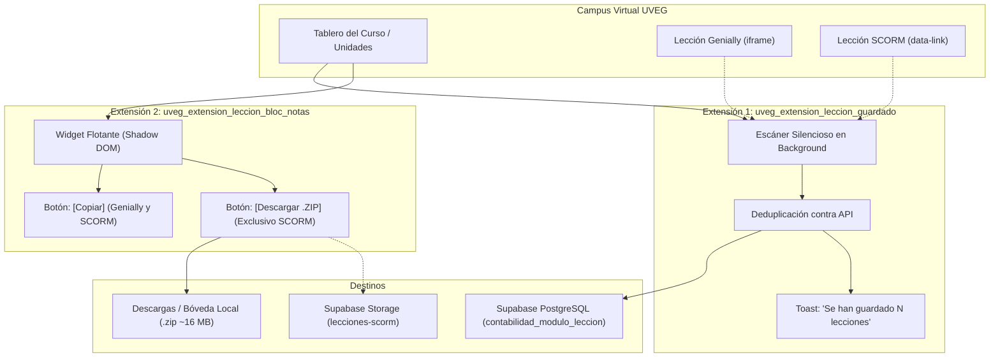

# Arquitectura y Estrategia de Preservación de Lecciones UVEG (Extensiones de Chrome + Supabase)

> **Módulo:** Planificador Personal / Contabilidad  
> **Área:** Automatización de Sincronización y Respaldo de Recursos Educativos  
> **Extensiones Involucradas:**  
> 1. `C:\xampp\htdocs\uveg_extension_leccion_guardado` (Sincronizador Silencioso a BD)  
> 2. `C:\xampp\htdocs\uveg_extension_leccion_bloc_notas` (Widget de Estudio y Descarga Selectiva)  
> **Servicios Externos:** Campus Virtual UVEG (Moodle) · Supabase (PostgreSQL + File Storage) · Laravel API  

---

## 1. Visión General del Ecosistema

Las materias de la **UVEG** combinan dentro del mismo curso dos naturalezas de recursos interactivos:
* **Presentaciones Genially:** Embebidas directamente como `<iframe>`, persistentes vía enlace web externo.
* **Lecciones SCORM / Articulate Storyline 360:** Cargadas mediante atributos `data-link=".../mod/scorm/view.php?id=..."`, empaquetadas en Moodle y que **dejan de estar accesibles cuando concluye el periodo académico**.

Para resolver esto sin fricción, el sistema divide el trabajo en dos extensiones independientes con responsabilidades claramente delimitadas:



---

## 2. Extensión 1: `uveg_extension_leccion_guardado`
### Objetivo: Sincronización Masiva Silenciosa a la Base de Datos

Esta extensión opera "por afuera", en el tablero principal o vista de secciones (`mainsection=2, 3, 4`) del curso.

### 2.1. Principios de Operación
1. **Cero Cambios Visuales (Front Intacto):** No añade botones ni paneles invasivos.
2. **Detección Mixta en un Solo Barrido:** Rastrea en la misma pasada lecciones en `<iframe>` (Genially) y lecciones con `data-link` (SCORM).
3. **Ligereza Absoluta:** No descarga archivos binarios pesados (ni imágenes ni audios). Solo envía payloads JSON ligeros a la API de Laravel/Supabase.
4. **Idempotencia (Deduplicación):** Si todas las lecciones del curso ya están registradas, mantiene **silencio absoluto**. Si hay lecciones nuevas, las inserta y emite un Toast discreto.

### 2.2. Lógica Interna de Detección Unificada (`content.js`)
El motor de escaneo clasifica los recursos según su origen:

```javascript
// content.js - Extracción unificada sin alterar el DOM
function encontrarLeccionesEnDocumento(doc = document) {
    const vistos = new Set();
    const encontrados = [];

    // 1. Detección de Genially embebido en iframes
    for (const iframe of doc.querySelectorAll('iframe')) {
        const src = iframe.getAttribute('src') || iframe.getAttribute('data-src') || iframe.src;
        if (!src || !esUrlRecurso(src)) continue;

        const urlNorm = normalizarUrl(src);
        if (vistos.has(urlNorm)) continue;
        vistos.add(urlNorm);

        encontrados.push({
            titulo: extraerTitulo(iframe, doc),
            url: src,
            tipo: 'genially'
        });
    }

    // 2. Detección de Lecciones SCORM con data-link o enlaces directos
    const selectoresScorm = '[data-link*="mod/scorm"], a[href*="mod/scorm/view.php"], .container-lesson, .img-leccion';
    for (const el of doc.querySelectorAll(selectoresScorm)) {
        const urlRaw = el.getAttribute('data-link') || el.getAttribute('href') || (el.querySelector('[data-link]')?.getAttribute('data-link'));
        if (!urlRaw) continue;

        const urlNorm = normalizarUrl(urlRaw);
        if (vistos.has(urlNorm)) continue;
        vistos.add(urlNorm);

        const contenedor = el.closest('.container-lesson, .activity, .contentitem') || el;
        const tituloEl = contenedor.querySelector('.titulo, .instancename, h3, h4') || el;
        const titulo = (tituloEl.innerText || tituloEl.textContent || el.getAttribute('alt') || el.getAttribute('title') || SIN_TITULO).trim();

        encontrados.push({
            titulo: titulo,
            url: urlRaw,
            tipo: 'scorm'
        });
    }

    return encontrados;
}
```

### 2.3. Notificación Final
Una vez que se ejecutan los `POST /api/contabilidad/lecciones` para las lecciones faltantes, se invoca el Toast existente:
> **` Se han guardado N lecciones`**

---

## 3. Extensión 2: `uveg_extension_leccion_bloc_notas`
### Objetivo: Asistente de Estudio y Descarga Selectiva para SCORM

Esta extensión inyecta un widget flotante en un **Shadow DOM** aislado. Facilita la toma de notas y el copiado rápido de recursos.

### 3.1. Detección Inteligente y Botón Selectivo
No todas las lecciones requieren ser descargadas en `.zip` (Genially se preserva vía web). Por ello, el botón de descarga se condiciona **exclusivamente al tipo de recurso**:

| Tipo de Recurso | Firma en el DOM | Botones Renderizados en la Ficha |
| :--- | :--- | :--- |
| **Genially** | `url.includes('genial.ly')` | `[ 📋 Copiar ]` *(Formato para bloc de notas)* |
| **SCORM / Storyline** | `url.includes('mod/scorm')` o `data-link` | `[ 📥 Descargar ]` + `[ 📋 Copiar ]` |

### 3.2. Renderizado Condicional de la Tarjeta (`content.js`)
```javascript
// Renderizado dentro de listaScroll en content.js
items.forEach((item) => {
    const tarjeta = document.createElement('div');
    tarjeta.className = 'item-tarjeta';

    const tituloEl = document.createElement('span');
    tituloEl.className = 'item-titulo';
    tituloEl.textContent = item.titulo;
    tarjeta.appendChild(tituloEl);

    const contenedorBotones = document.createElement('div');
    contenedorBotones.className = 'acciones-tarjeta';

    // BOTÓN SELECTIVO: Solo para lecciones SCORM
    const esScorm = item.tipo === 'scorm' || /mod\/scorm|mod_scorm/i.test(item.url);
    if (esScorm) {
        const btnDescargar = document.createElement('button');
        btnDescargar.type = 'button';
        btnDescargar.className = 'btn-descargar-scorm';
        btnDescargar.innerHTML = `${SVG_DESCARGA}<span>Descargar</span>`;
        btnDescargar.title = 'Descargar paquete completo offline (.zip)';
        
        btnDescargar.addEventListener('click', async (e) => {
            e.stopPropagation();
            await ejecutarDescargaScorm(item, btnDescargar);
        });

        contenedorBotones.appendChild(btnDescargar);
    }

    // BOTÓN ESTÁNDAR: Copiar para bloc de notas (Todos los recursos)
    const btnCopiar = document.createElement('button');
    btnCopiar.type = 'button';
    btnCopiar.className = 'btn-copiar-item';
    btnCopiar.innerHTML = `${SVG_COPIAR}<span>Copiar</span>`;
    btnCopiar.addEventListener('click', (e) => ejecutarCopia(e, item, tarjeta, btnCopiar));

    contenedorBotones.appendChild(btnCopiar);
    tarjeta.appendChild(contenedorBotones);
    listaScroll.appendChild(tarjeta);
});
```

### 3.3. Comportamiento del Botón de Descarga
Al presionar `[ 📥 Descargar ]`:
1. El botón refleja el estado: `[ ⏳ 15%... ]` ➔ `[ ⏳ 70%... ]` ➔ `[ 📦 Empaquetando... ]`.
2. El script resuelve la ruta `/pluginfile.php/.../mod_scorm/content/X/`.
3. Descarga los 129 archivos binarios en memoria con `arrayBuffer()`.
4. El generador Vanilla JS ensambla el ZIP con atributos MS-DOS (`0x20` y fecha DOS), evitando el error de 0 KB en Windows.
5. El navegador dispara la descarga directa del archivo: `Leccion_<Codigo>_Completa.zip` (~16 MB).
6. El botón finaliza con: `[ ✔ ¡Descargado! ]`.

---

## 4. Análisis de Viabilidad de Almacenamiento (Supabase vs Google Drive vs Local)

### 4.1. Inviabilidad de Google Drive para Streaming en Vivo
* **Google Drive NO es un servidor web estático:** Asigna IDs únicos a los archivos y no preserva rutas relativas de carpetas (`html5/data/js/slide1.js`). `story.html` se rompe inmediatamente.
* **Bloqueo por cabeceras:** Envía `X-Frame-Options: SAMEORIGIN`, impidiendo su inclusión en el modal `IframeModal` del Planificador.
* **Uso correcto de Google Drive:** Solo como **almacén de copias de seguridad (.zip)** en frío.

### 4.2. Viabilidad Cuantitativa de Supabase (Plan Gratuito)

| Métrica en Supabase | Límite Gratuito | Consumo por Lección | Capacidad Práctica | Evaluación |
| :--- | :--- | :--- | :--- | :---: |
| **File Storage** | **1 GB** (1,024 MB) | ~16 MB por lección | **~60 a 64 lecciones** (~10 a 12 materias) | ⚠️ Justo a largo plazo |
| **Egress (Transferencia)** | **5 GB / mes** | ~16 MB por carga limpia | **~310 visualizaciones / mes** |  **Sobra para 1 usuario** |
| **Database Size** | **500 MB** *(28 MB en uso)* | < 1 KB por registro | Miles de registros de materias |  **Ilimitado para metadatos** |

> [!TIP]
> **Estrategia Híbrida Recomendada:**
> Mantener en Supabase Storage únicamente las materias del cuatrimestre activo (~3 a 5 materias = ~400 MB). Al finalizar y aprobar una materia, su paquete se archiva a local en `planificador_personal/public/lecciones/` o a Google Drive, liberando la cuota de 1 GB en la nube.

---

## 5. Tabla Comparativa de Responsabilidades

| Dimensión | Extensión 1 (`leccion_guardado`) | Extensión 2 (`leccion_bloc_notas`) |
| :--- | :--- | :--- |
| **Propósito Principal** | Registro administrativo en Base de Datos. | Utilidad de estudio y preservación interactiva. |
| **Contexto de Ejecución** | Tablero principal / Vista general de unidades. | Pantalla de estudio / Widget flotante interactivo. |
| **Interfaz de Usuario** | 100% invisible (solo Toast final en esquina). | Panel flotante arrastrable con Shadow DOM. |
| **Tratamiento de Genially** | Registra la URL en `contabilidad_modulo_leccion`. | Genera formato de texto para portapapeles. |
| **Tratamiento de SCORM** | Registra el `data-link` en la base de datos. | Permite **descarga del ZIP completo de 16 MB**. |
| **Consumo de Ancho de Banda** | Insignificante (pocos bytes en JSON). | ~16 MB únicamente al hacer clic en Descargar. |
