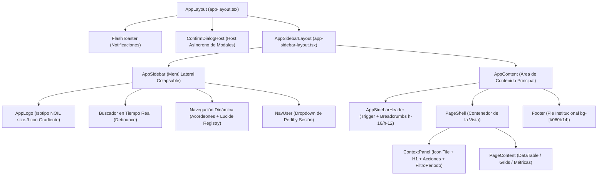

# Manual de Arquitectura Visual y Patrones de Diseño (Estándar UI Noil v1.6)

> **Repositorio de Referencia:** `c:\xampp\htdocs\sspa_web2022`  
> **Aplicación Receptora:** `c:\xampp\htdocs\planificador_personal`  
> **Stack:** Laravel 12 · Inertia.js (React 19) · Tailwind CSS v4 · TypeScript · Lucide React · Radix UI (shadcn)  
> **Normativa Oficial:** Estándar UI Noil v1.6 (adaptado del estándar corporativo de `appweb_proveedores`)

---

## 1. Filosofía y Principios Rectores del Diseño

1. **Solo Modo Claro (Light Mode Exclusivo):**  
   El modo oscuro está deshabilitado a nivel estructural en `:root`. Queda **estrictamente prohibido** utilizar la variante `dark:` o implementar alternadores de tema.
2. **Cero Estilos Inline o Colores Arbitrarios:**  
   Nunca usar clases arbitrarias como `bg-blue-600`, `#2463EB` o `text-gray-500`. Todo color debe derivarse de los tokens semánticos de Tailwind v4 (`bg-primary`, `text-muted-foreground`, `border-border`, etc.).
3. **Jerarquía Tipográfica Clara con Plus Jakarta Sans:**  
   Se utiliza la fuente *Plus Jakarta Sans*. Los títulos H1, H2 y H3 deben llevar `tracking-tight`. Los números grandes o KPIs utilizan `tabular-nums font-bold` o `font-extrabold`.
4. **Sombras con Tinte Azul:**  
   Prohibidas las sombras grises genéricas. Las sombras en tarjetas y modales usan los tokens `--shadow-sm` y `--shadow-lg`, los cuales incorporan un matiz azulado para dar profundidad profesional.
5. **Regla de Una Sola Capa (No Drawers sobre Drawers):**  
   Un `Sheet` jamás debe abrir otro `Sheet` encima. Cualquier alta rápida de catálogo o confirmación secundaria se realiza mediante un `Dialog` centrado.

---

## 2. Jerarquía Global del Layout y Shell

Toda pantalla autenticada se construye siguiendo la jerarquía estricta:

$$\text{AppLayout} \longrightarrow \text{AppSidebarLayout} \longrightarrow \text{AppShell} \longrightarrow [\text{AppSidebar} + \text{AppContent} (\text{AppSidebarHeader} + \text{PageShell} + \text{Footer})]$$



### 2.1. Componentes del Shell
- **`AppLayout` (`app-layout.tsx`):**  
  Punto de entrada. Monta `ConfirmDialogHost` y `FlashToaster`. Recibe el prop `breadcrumbs: BreadcrumbItem[]`.
- **`AppSidebarHeader` (`app-sidebar-header.tsx`):**  
  Altura fija de `h-16` (se reduce a `h-12` cuando la barra está colapsada en modo compacto). Contiene el botón `SidebarTrigger` y la ruta de navegación interactiva `Breadcrumbs`.
- **`AppSidebar` (`app-sidebar.tsx`):**  
  Sidebar oscuro permanente (`bg-sidebar`). Cuenta con buscador instantáneo de módulos con debounce, atajos de teclado (`Escape` limpia, `Enter` navega a la primera coincidencia), acordeones con rotación animada de flecha, y mapeo de iconos dinámico mediante Lucide.
- **`Footer` (`footer.tsx`):**  
  Pie de página permanente `bg-[#060b14]` con borde superior `border-slate-900`. Muestra derechos reservados, enlaces de privacidad y el isotipo de DSAIX.

---

## 3. Tokens de Diseño y Colores (Tailwind CSS v4)

Los tokens se declaran en `resources/css/app.css` mediante la sintaxis nativa `@theme inline`:

| Token Semántico | Valor HSL / HEX | Función en la Interfaz |
|---|---|---|
| `--primary` | `hsl(221 83% 53%)` / `#2463EB` | Botones de acción primaria, badges activos, bordes de foco |
| `--primary-foreground` | `hsl(0 0% 100%)` / `#FFFFFF` | Texto e iconos sobre superficies primarias |
| `--background` | `hsl(213 100% 98%)` / `#F5F9FF` | Fondo global de toda la aplicación (azul ultra-tenue) |
| `--card` / `--popover` | `hsl(0 0% 100%)` / `#FFFFFF` | Superficie de tarjetas, paneles, tablas y drawers |
| `--foreground` | `hsl(222 47% 11%)` / `#0F1729` | Texto principal, encabezados H1-H4 |
| `--muted` / `--secondary`| `hsl(210 40% 96%)` / `#EEF2F6` | Fondos de controles deshabilitados, filas alternas |
| `--muted-foreground` | `hsl(215 19% 47%)` / `#61748F` | Descripciones, placeholders, micro-etiquetas |
| `--border` / `--input` | `hsl(214 32% 89%)` / `#DAE2EC` | Líneas divisorias, bordes de inputs y tablas |
| `--destructive` | `hsl(0 72% 51%)` / `#DC2828` | Botones de eliminación, banners de error, alertas |
| `--sidebar` | `hsl(222 47% 11%)` / `#0F1729` | Fondo profundo de la barra lateral |

### 3.1. Radios de Borde (`border-radius`)
- `rounded-full`: Insignias (badges), botones de acción de fila (32px), chips de estado.
- `rounded-md`: Botones de acción estándar, inputs, selects, comboboxes.
- `rounded-xl`: Tarjetas estándar, isotipo de logo (`size-9 rounded-xl`).
- `rounded-2xl`: Paneles de contexto (`ContextPanel`), hero banners, diálogos modales.

---

## 4. Patrón de Listados: `ContextPanel` y `DataTable`

Toda vista principal de módulo (`index.tsx`) se estructura con `ContextPanel` como encabezado de tarjeta y `DataTable` como visor de datos.

### 4.1. Panel de Contexto (`ContextPanel.tsx`)
Consta de una estructura de dos renglones:
1. **Renglón 1 (Identidad y Acciones Rápidas):**
   - **Tile de Icono:** Caja de 40px (`size-10 rounded-xl bg-primary/10 text-primary flex items-center justify-center`).
   - **Títulos:** Título de página (`text-lg font-semibold tracking-tight text-foreground`) y descripción explicativa (`text-xs text-muted-foreground`).
   - **Acciones:** Botón principal de alta ("Nuevo...") en tamaño `size="sm"`, deshabilitado si el usuario carece de permiso.
2. **Renglón 2 (Filtros de Contexto):**
   - Contenedor con fondo tenue `bg-muted/30` y borde superior `border-t border-border`.
   - Aloja el componente `FiltroPeriodo` con `DateInputPicker` (`Desde` y `Hasta`) más botones de *Filtrar* y *Limpiar*.

### 4.2. Tabla de Datos (`DataTable.tsx`)
- **Barra de Herramientas (Toolbar Estricto):**  
  `[Buscador con Debounce] ── [Exportar CSV] ── [Columnas Visibles] ── [Recargar] ── [Nuevo Registro]`
- **Detección Automática de Recargas Parciales (`effectiveReloadOnly`):**  
  Inspecciona los props de la página con `usePage()`. Si la ruta devuelve `{ registros, filters }`, al buscar, paginar o cambiar columnas solo pide a Inertia esa clave, optimizando la latencia de red.
- **Formateo de Celdas:**
  - Valores nulos o vacíos se renderizan obligatoriamente con guion largo: `'—'`.
  - Fechas formateadas con `formatDate(r.Fecha)` (`dd/mm/aaaa`).
- **Botones de Acción en Fila:**  
  Botones circulares de 32px (`size-8 rounded-full variant="ghost"`):
  - Ver detalle: `<Eye className="size-4 text-blue-600" />`
  - Editar: `<Pencil className="size-4 text-amber-600" />`
  - Eliminar: `<Trash2 className="size-4 text-rose-600" />` (dispara `confirmDialog`)
- **Insignias de Estado Semánticas:**
  - `StatusBadge` (Verde / `success`): "Activo", "Autorizado", "Finalizado".
  - `WarningBadge` (Amarillo / `warning`): "Pendiente", "Requiere Atención".
  - `InfoBadge` (Azul / `info`): "En Proceso", "En Ejecución", "Asignado".
  - `DangerBadge` (Rojo / `danger`): "Cancelado", "Rechazado", "Inactivo".

---

## 5. Patrón del Drawer de Captura (`*-form-drawer.tsx`)

El estándar `/capacitacion` de SSPA define la anatomía obligatoria para formularios de alta y modificación mediante un `Sheet` lateral derecho.

### 5.1. Reglas Estructurales Mandatorias
1. **Anchos Permitidos:**  
   - `sm:max-w-xl` (576px) para formularios verticales de una columna.  
   - `sm:max-w-2xl` (672px) para formularios en rejilla de dos columnas (`grid grid-cols-1 sm:grid-cols-2 gap-4`).  
   - *Queda prohibido el uso de `sm:max-w-md` o anchos fijos en píxeles.*
2. **Formulario Desacoplado del Footer:**  
   El `<form id="[entidad]-form">` envuelve los campos con scroll independiente (`overflow-y-auto`). El `<SheetFooter>` se coloca **fuera** del form, vinculado mediante el atributo `form="[entidad]-form"`.
3. **Separador Visual:**  
   Se ubica `<Separator className="my-2" />` inmediatamente antes del `<SheetFooter>`.
4. **Botones del Footer:**  
   Ambos botones llevan `className="flex-1 sm:flex-none"`. El botón Cancelar usa `variant="outline"` y el botón Guardar muestra `Loader2` giratorio si `processing` es verdadero.

### 5.2. Anatomía Interna del Formulario
1. **Banner de Errores Globales:**  
   `<FormErrorBanner errors={errors} campos={Object.keys(data)} />` colocado en la cima de los campos.
2. **Subencabezados de Sección:**  
   Dividen temáticamente los formularios largos:
   ```tsx
   <div className="space-y-1">
       <h4 className="flex items-center gap-2 text-sm font-medium text-foreground">
           <Briefcase className="size-4 text-primary" />
           Información General
       </h4>
       <p className="text-xs text-muted-foreground">
           Detalles esenciales de la solicitud
       </p>
   </div>
   ```
3. **Inputs con Iconos a la Izquierda:**  
   Los campos estándar van envueltos con icono visual:
   ```tsx
   <Field>
       <FieldLabel htmlFor="clave" required>Clave del Puesto</FieldLabel>
       <div className="relative">
           <Hash className="absolute top-1/2 left-3 size-4 -translate-y-1/2 text-muted-foreground" />
           <Input
               id="clave"
               value={data.clave}
               onChange={(e) => setData('clave', e.target.value)}
               className="pl-10"
               placeholder="Ej. OP-01"
               aria-invalid={!!errors.clave}
           />
       </div>
       <FieldError>{errors.clave}</FieldError>
   </Field>
   ```
4. **Campos Autodefinidos o de Solo Lectura:**  
   Folios generados por el sistema, fechas actuales o relaciones fijas deben mostrarse con atributo `disabled`, **nunca ocultos ni en inputs `type="hidden"`**.

---

## 6. Patrón de Confirmación y Modales (`confirmDialog`)

Se prohíbe terminantemente el uso de `window.confirm()`. Todas las operaciones irreversibles deben usar el diálogo asíncrono tipado `confirmDialog`.

### 6.1. Invocación Estándar
```tsx
import { confirmDialog } from '@/components/confirm-dialog';

const handleDelete = async (item: MiEntidad) => {
    const confirmed = await confirmDialog({
        title: '¿Eliminar registro?',
        description: `Esta acción no se puede deshacer. Se eliminará permanentemente "${item.nombre}".`,
        confirmText: 'Sí, eliminar',
        cancelText: 'Cancelar',
        variant: 'destructive',
    });

    if (confirmed) {
        router.delete(`/mi-modulo/${item.id}`, {
            preserveScroll: true,
        });
    }
};
```

---

## 7. Controles de Formulario: Decisiones de Uso

| Necesidad de UI | Componente Obligatorio | Prohibición Absoluta |
|---|---|---|
| Lista cerrada $\le 10$ opciones | `Select` (Radix UI) de `@/components/ui/select` | `<select>` HTML nativo |
| Lista extensa o con búsqueda ($> 10$ opciones) | `Combobox` con filtro en tiempo real | `<select>` nativo o Radix `Select` gigante |
| Selección de Fechas | `DateInputPicker` (`dd/mm/aaaa`, localizado) | `<input type="date">` |
| Valores Booleanos (Sí / No) | `Switch` de `@/components/ui/switch` | `<input type="checkbox">` suelto |
| Etiquetas y Validación | `Field` + `FieldLabel` + `FieldError` | `<label>` suelto sin enlace `htmlFor` |
| Textos Multilínea | `Textarea` de 40px iniciales con `rounded-lg` | `<textarea>` sin estilos de tema |

---

## 8. Plantillas Canónicas Listas para Producción

### 8.1. Plantilla Canónica: `index.tsx`
```tsx
import { useState } from 'react';
import { Head, router } from '@inertiajs/react';
import { Plus, Tag } from 'lucide-react';
import { AppLayout } from '@/layouts/app/app-sidebar-layout';
import { PageShell, PageContent } from '@/components/page-shell';
import { ContextPanel, FiltroPeriodo } from '@/components/context-panel';
import { DataTable, type Column, StatusBadge } from '@/components/data-table';
import { Button } from '@/components/ui/button';
import { confirmDialog } from '@/components/confirm-dialog';
import { formatDate, hoy, inicioDeMes } from '@/lib/fechas';
import { EntidadFormDrawer } from '@/components/modulo/entidad-form-drawer';
import type { BreadcrumbItem } from '@/types';

interface Entidad {
    id: number;
    folio: string;
    nombre: string;
    fecha: string;
    activo: boolean;
}

interface Props {
    registros: {
        data: Entidad[];
        current_page: number;
        last_page: number;
        per_page: number;
        total: number;
    };
    filters?: {
        desde?: string;
        hasta?: string;
    };
}

const breadcrumbs: BreadcrumbItem[] = [
    { title: 'Inicio', href: '/dashboard' },
    { title: 'Catálogos', href: '#' },
    { title: 'Entidades', href: '/entidades' },
];

export default function Index({ registros, filters = {} }: Props) {
    const [isDrawerOpen, setIsDrawerOpen] = useState(false);
    const [selectedItem, setSelectedItem] = useState<Entidad | null>(null);
    const [desde, setDesde] = useState(filters.desde || inicioDeMes());
    const [hasta, setHasta] = useState(filters.hasta || hoy());

    const columns: Column<Entidad>[] = [
        { key: 'folio', label: 'Folio', sortable: true },
        { key: 'nombre', label: 'Nombre', sortable: true, render: (r) => r.nombre || '—' },
        { key: 'fecha', label: 'Fecha', render: (r) => formatDate(r.fecha) },
        { key: 'activo', label: 'Estatus', render: (r) => <StatusBadge active={r.activo} /> },
    ];

    const handleCreate = () => {
        setSelectedItem(null);
        setIsDrawerOpen(true);
    };

    const handleEdit = (item: Entidad) => {
        setSelectedItem(item);
        setIsDrawerOpen(true);
    };

    const handleDelete = async (item: Entidad) => {
        const ok = await confirmDialog({
            title: '¿Eliminar registro?',
            description: `Se eliminará permanentemente el registro "${item.nombre}".`,
            confirmText: 'Sí, eliminar',
            cancelText: 'Cancelar',
            variant: 'destructive',
        });

        if (ok) {
            router.delete(`/entidades/${item.id}`, { preserveScroll: true });
        }
    };

    const handleFiltrar = () => {
        router.get('/entidades', { desde, hasta }, { preserveState: true, replace: true });
    };

    const handleLimpiar = () => {
        setDesde('');
        setHasta('');
        router.get('/entidades', {}, { preserveState: true, replace: true });
    };

    return (
        <AppLayout breadcrumbs={breadcrumbs}>
            <Head title="Entidades" />
            <PageShell>
                <ContextPanel
                    icon={<Tag />}
                    title="Catálogo de Entidades"
                    description="Administración y consulta del listado de entidades."
                    actions={
                        <Button size="sm" onClick={handleCreate}>
                            <Plus className="size-4" /> Nueva Entidad
                        </Button>
                    }
                    filtros={
                        <FiltroPeriodo
                            desde={desde}
                            hasta={hasta}
                            onDesde={setDesde}
                            onHasta={setHasta}
                            onAplicar={handleFiltrar}
                            onLimpiar={handleLimpiar}
                        />
                    }
                />
                <PageContent>
                    <DataTable
                        data={registros.data}
                        columns={columns}
                        pagination={registros}
                        baseUrl="/entidades"
                        exportar="entidades"
                        onEdit={handleEdit}
                        onDelete={handleDelete}
                    />
                </PageContent>
            </PageShell>

            <EntidadFormDrawer
                open={isDrawerOpen}
                onOpenChange={setIsDrawerOpen}
                item={selectedItem}
            />
        </AppLayout>
    );
}
```

---

### 8.2. Plantilla Canónica: `entidad-form-drawer.tsx`
```tsx
import { useEffect } from 'react';
import { useForm } from '@inertiajs/react';
import { Hash, FileText, Loader2 } from 'lucide-react';
import {
    Sheet,
    SheetClose,
    SheetContent,
    SheetDescription,
    SheetFooter,
    SheetHeader,
    SheetTitle,
} from '@/components/ui/sheet';
import { Button } from '@/components/ui/button';
import { Input } from '@/components/ui/input';
import { Separator } from '@/components/ui/separator';
import { Switch } from '@/components/ui/switch';
import { Field, FieldError, FieldGroup, FieldLabel } from '@/components/ui/field';
import { FormErrorBanner } from '@/components/ui/form-error-banner';

interface Entidad {
    id: number;
    folio: string;
    nombre: string;
    activo: boolean;
}

interface Props {
    open: boolean;
    onOpenChange: (open: boolean) => void;
    item: Entidad | null;
}

export function EntidadFormDrawer({ open, onOpenChange, item }: Props) {
    const isEditing = !!item;

    const { data, setData, post, put, processing, errors, reset, clearErrors } = useForm({
        folio: '',
        nombre: '',
        activo: true,
    });

    useEffect(() => {
        if (open) {
            clearErrors();
            if (item) {
                setData({
                    folio: item.folio,
                    nombre: item.nombre,
                    activo: item.activo,
                });
            } else {
                reset();
                setData('folio', 'AUTO');
            }
        }
    }, [open, item]);

    const handleSubmit = (e: React.FormEvent) => {
        e.preventDefault();

        if (isEditing) {
            put(`/entidades/${item.id}`, {
                preserveScroll: true,
                onSuccess: () => onOpenChange(false),
            });
        } else {
            post('/entidades', {
                preserveScroll: true,
                onSuccess: () => onOpenChange(false),
            });
        }
    };

    return (
        <Sheet open={open} onOpenChange={onOpenChange}>
            <SheetContent className="overflow-y-auto sm:max-w-xl">
                <SheetHeader>
                    <SheetTitle>{isEditing ? 'Editar Entidad' : 'Nueva Entidad'}</SheetTitle>
                    <SheetDescription>
                        {isEditing
                            ? 'Modifique los campos correspondientes del registro.'
                            : 'Complete la información para dar de alta una nueva entidad.'}
                    </SheetDescription>
                </SheetHeader>

                <form id="entidad-form" onSubmit={handleSubmit} className="flex flex-col gap-5 px-6 py-4">
                    <FormErrorBanner errors={errors} campos={Object.keys(data)} />

                    <div className="space-y-1">
                        <h4 className="flex items-center gap-2 text-sm font-medium text-foreground">
                            <FileText className="size-4 text-primary" />
                            Datos Principales
                        </h4>
                        <p className="text-xs text-muted-foreground">
                            Identificación de la entidad en el sistema.
                        </p>
                    </div>

                    <FieldGroup>
                        <Field>
                            <FieldLabel htmlFor="entidad-folio">Folio del Sistema</FieldLabel>
                            <div className="relative">
                                <Hash className="absolute top-1/2 left-3 size-4 -translate-y-1/2 text-muted-foreground" />
                                <Input
                                    id="entidad-folio"
                                    value={data.folio}
                                    disabled
                                    className="pl-10 bg-muted cursor-not-allowed"
                                />
                            </div>
                        </Field>

                        <Field>
                            <FieldLabel htmlFor="entidad-nombre" required>Nombre</FieldLabel>
                            <Input
                                id="entidad-nombre"
                                value={data.nombre}
                                onChange={(e) => setData('nombre', e.target.value)}
                                placeholder="Nombre descriptivo"
                                aria-invalid={!!errors.nombre}
                            />
                            <FieldError>{errors.nombre}</FieldError>
                        </Field>

                        <Field className="flex flex-row items-center justify-between rounded-lg border border-border p-3">
                            <div className="space-y-0.5">
                                <FieldLabel htmlFor="entidad-activo">Estatus Activo</FieldLabel>
                                <p className="text-xs text-muted-foreground">Habilita el registro en catálogos operativos.</p>
                            </div>
                            <Switch
                                id="entidad-activo"
                                checked={data.activo}
                                onCheckedChange={(val) => setData('activo', val)}
                            />
                        </Field>
                    </FieldGroup>
                </form>

                <Separator className="my-2" />

                <SheetFooter>
                    <SheetClose asChild>
                        <Button type="button" variant="outline" disabled={processing} className="flex-1 sm:flex-none">
                            Cancelar
                        </Button>
                    </SheetClose>
                    <Button type="submit" form="entidad-form" disabled={processing} className="flex-1 sm:flex-none">
                        {processing && <Loader2 className="mr-2 size-4 animate-spin" />}
                        {isEditing ? 'Guardar Cambios' : 'Registrar Entidad'}
                    </Button>
                </SheetFooter>
            </SheetContent>
        </Sheet>
    );
}
```

---

## 9. Lista de Verificación (Definition of Done) para Vistas y Componentes

Antes de considerar concluida una pantalla o drawer en el ecosistema NOIL:

- [ ] **Sin variantes oscuras:** No existen clases `dark:` ni estilos de modo noche.
- [ ] **Tokens respetados:** No se emplean colores hexadecimales o clases arbitrarias como `bg-blue-600`.
- [ ] **Estructura de listado:** La vista utiliza `PageShell`, `ContextPanel` con icono de 40px, y `DataTable`.
- [ ] **DataTable optimizada:** El toolbar sigue el orden estándar y la recarga parcial con `usePage()` está operativa.
- [ ] **Valores nulos en tablas:** Celdas sin dato renderizan `'—'`.
- [ ] **Fechas localizadas:** Se formatean visualmente con `formatDate()` y se capturan con `DateInputPicker`.
- [ ] **Sin `<select>` HTML nativo:** Se utiliza Radix `Select` o `Combobox`.
- [ ] **Drawer canónico:** Ancho estricto `sm:max-w-xl` o `sm:max-w-2xl`, `<form id="...">` desacoplado del footer con `<Separator className="my-2" />`.
- [ ] **Acciones de guardado:** Botones del footer con `className="flex-1 sm:flex-none"`, spinner `Loader2` y bloqueo con `disabled={processing}`.
- [ ] **Confirmaciones seguras:** Eliminaciones y acciones destructivas usan `await confirmDialog()`.
- [ ] **Compilación limpia:** Pasa sin advertencias ni errores `npm run build` o `npx tsc --noEmit`.
