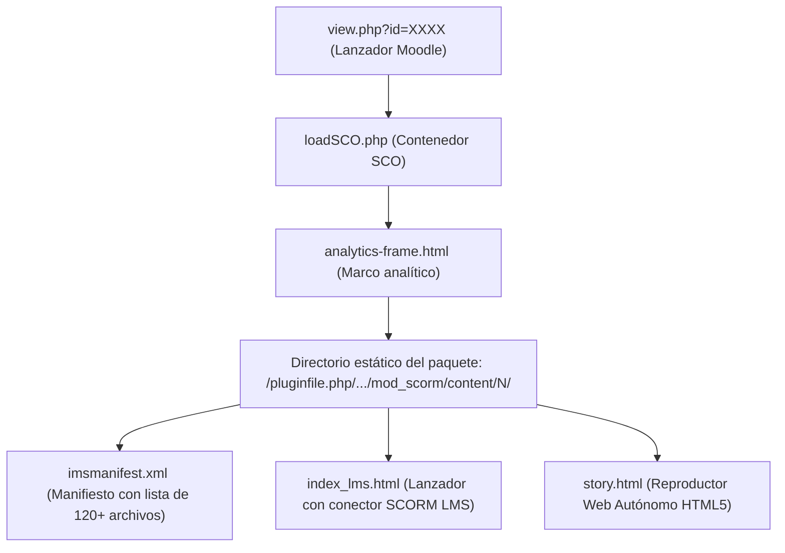

# Preservación de Lecciones Multimedia SCORM (UVEG)

> **Módulo:** Planificador Personal / Contabilidad  
> **Área:** Preservación de Recursos Educativos Offline  
> **Tecnología de Origen:** Moodle SCORM 1.2 / 2004 · Articulate Storyline 360 (HTML5)  
> **Ubicación Local en Proyecto:** `public/lecciones/<Identificador_Leccion>/`  
> **URL de Reproducción:** `/lecciones/<Identificador_Leccion>/story.html`

---

## 1. Contexto y Justificación

Al cursar materias en la plataforma virtual de la **UVEG**, los módulos educativos cierran su acceso al concluir el periodo de estudio. Como resultado, las lecciones interactivas dejan de estar disponibles para el alumno.

Existen dos tipos principales de recursos interactivos en la plataforma:
1. **Presentaciones Genially:** Se integran vía *iframe* externo y pueden consultarse o respaldarse mediante su enlace de visualización directa.
2. **Lecciones SCORM / Articulate Storyline 360:** Son paquetes HTML5 completos (con interactividad, audios, diapositivas y animaciones) alojados dentro del sistema Moodle (`mod_scorm`).

Este documento establece el procedimiento técnico definitivo para **descargar, empaquetar, almacenar e integrar localmente** cualquier lección SCORM de la UVEG en el **Planificador Personal**, permitiendo su visualización indefinida dentro del modal del sistema (`IframeModal`) sin requerir conexión a internet ni acceso a Moodle.

---

## 2. Anatomía Técnica del Recurso SCORM en UVEG

Cuando el usuario hace clic en el enlace de la lección (``), la plataforma realiza la siguiente cascada:



### URL Base del Paquete
La ruta base de los archivos estáticos tiene la siguiente estructura:
```
https://avalicmod19d.uveg.edu.mx/pluginfile.php/<FILE_ID>/mod_scorm/content/<VERSION_ID>/
```
*Ejemplo real:* `https://avalicmod19d.uveg.edu.mx/pluginfile.php/8848/mod_scorm/content/9/`

---

## 3. Trampas Técnicas y Soluciones Implementadas

Durante el desarrollo de la extracción se identificaron 4 desafíos críticos:

### 3.1. Política de Seguridad CSP (Content Security Policy)
* **Problema:** UVEG prohíbe cargar scripts externos desde CDNs (`cdnjs.cloudflare.com`, `jsdelivr.net`, etc.). Intentar inyectar bibliotecas como `JSZip` produce el error:
  `Loading the script 'https://cdnjs...' violates CSP directive: default-src 'self' uveg.edu.mx`.
* **Solución:** Se implementó una clase compacta de compresión ZIP en **JavaScript Puro (Vanilla JS)** con generador de tabla CRC32. Funciona de manera autónoma en memoria con `Uint8Array`, `DataView` y `Blob`, con cero dependencias externas.

### 3.2. Error de lectura del Manifiesto por Namespaces XML
* **Problema:** El archivo `imsmanifest.xml` incluye definiciones de namespace como `xmlns="http://www.imsglobal.org/xsd/imscp_v1p1"`. Si se procesa con `DOMParser` y `querySelectorAll("file")`, devuelve **0 elementos**, provocando que solo se descarguen archivos por defecto.
* **Solución:** Se extraen las rutas leyendo el texto plano del manifiesto con expresiones regulares globales:
  ```javascript
  const fileRegex = /<file\b[^>]*\bhref=["']([^"']+)["']/gi;
  const resRegex = /<resource\b[^>]*\bhref=["']([^"']+)["']/gi;
  ```

### 3.3. Archivos vacíos de 0 KB al descomprimir en Windows
* **Problema:** El Explorador de Archivos de Windows requiere que la cabecera del ZIP incluya marcas de tiempo MS-DOS válidas y atributos externos de archivo. Si estos campos se envían en `0`, Windows interpreta que los archivos están dañados y los crea con **0 KB**.
* **Solución:** En las cabeceras Local y Central del ZIP se establecen los valores estándar de DOS y el atributo `0x20` (*FILE_ATTRIBUTE_ARCHIVE*):
  - `dosTime = 0x6000` (12:00:00)
  - `dosDate = 0x58A1` (01/05/2024)
  - `externalFileAttributes = 0x20` (Archivo normal en Windows)

### 3.4. Alerta "unable to acquire LMS API"
* **Problema:** Al descomprimir y abrir `index_lms.html`, aparece la alerta:
  > *"Error - unable to acquire LMS API, content may not play properly and results may not be recorded."*
* **Causa:** `index_lms.html` tiene la bandera `lmsPresent: true` e intenta conectarse con el servidor de calificaciones de Moodle (`window.API`).
* **Solución:** El punto de entrada correcto para reproducción local es **`story.html`**. Este archivo tiene `lmsPresent: false` configurado de fábrica por Articulate Storyline, ejecutando la lección de manera 100% interactiva sin buscar a Moodle.

---

## 4. Script Descargador Autónomo (Consola DevTools)

Para respaldar cualquier lección futura, abre la lección en el navegador, abre la **Consola de DevTools (F12)** y ejecuta el siguiente script:

```javascript
(async function descargarLeccionUVEG() {
    console.log("%c [1/4] Iniciando descargador autónomo...", "color: #0284c7; font-weight: bold; font-size: 14px;");

    // 1. Motor CRC32 en memoria
    const crcTable = new Uint32Array(256);
    for (let i = 0; i < 256; i++) {
        let c = i;
        for (let k = 0; k < 8; k++) c = (c & 1) ? (0xEDB88320 ^ (c >>> 1)) : (c >>> 1);
        crcTable[i] = c;
    }
    function calcCRC32(buf) {
        let crc = 0xFFFFFFFF;
        for (let i = 0; i < buf.length; i++) crc = crcTable[(crc ^ buf[i]) & 0xFF] ^ (crc >>> 8);
        return (crc ^ 0xFFFFFFFF) >>> 0;
    }

    // 2. Generador ZIP binario compatible con Windows Explorer
    class WindowsCompatibleZip {
        constructor() { this.files = []; }
        add(name, uint8) {
            this.files.push({ name: name.replace(/^\/+/, ''), data: uint8 });
        }
        buildBlob() {
            const parts = [];
            const central = [];
            let offset = 0;
            const enc = new TextEncoder();

            const dosTime = 0x6000; // 12:00:00
            const dosDate = 0x58A1; // 2024-05-01

            for (const f of this.files) {
                const nb = enc.encode(f.name);
                const crc = calcCRC32(f.data);
                const size = f.data.length;

                // Cabecera local (30 bytes)
                const h = new Uint8Array(30);
                const hv = new DataView(h.buffer);
                hv.setUint32(0, 0x04034b50, true);
                hv.setUint16(4, 20, true);
                hv.setUint16(6, 0x0800, true);     // UTF-8
                hv.setUint16(8, 0, true);          // Store (sin compresión adicional)
                hv.setUint16(10, dosTime, true);
                hv.setUint16(12, dosDate, true);
                hv.setUint32(14, crc, true);
                hv.setUint32(18, size, true);
                hv.setUint32(22, size, true);
                hv.setUint16(26, nb.length, true);
                hv.setUint16(28, 0, true);

                parts.push(h, nb, f.data);

                // Cabecera del directorio central (46 bytes)
                const ch = new Uint8Array(46);
                const chv = new DataView(ch.buffer);
                chv.setUint32(0, 0x02014b50, true);
                chv.setUint16(4, 20, true);
                chv.setUint16(6, 20, true);
                chv.setUint16(8, 0x0800, true);
                chv.setUint16(10, 0, true);
                chv.setUint16(12, dosTime, true);
                chv.setUint16(14, dosDate, true);
                chv.setUint32(16, crc, true);
                chv.setUint32(20, size, true);
                chv.setUint32(24, size, true);
                chv.setUint16(28, nb.length, true);
                chv.setUint16(30, 0, true);
                chv.setUint16(32, 0, true);
                chv.setUint16(34, 0, true);
                chv.setUint16(36, 0, true);
                chv.setUint32(38, 0x20, true);     // Atributo Windows Archive (Previene archivos 0 KB)
                chv.setUint32(42, offset, true);

                central.push(ch, nb);
                offset += h.length + nb.length + size;
            }

            const cdOffset = offset;
            let cdSize = 0;
            for (const p of central) cdSize += p.length;

            // Fin del directorio central (22 bytes)
            const eocd = new Uint8Array(22);
            const ev = new DataView(eocd.buffer);
            ev.setUint32(0, 0x06054b50, true);
            ev.setUint16(8, this.files.length, true);
            ev.setUint16(10, this.files.length, true);
            ev.setUint32(12, cdSize, true);
            ev.setUint32(16, cdOffset, true);

            return new Blob([...parts, ...central, eocd], { type: "application/zip" });
        }
    }

    try {
        // Detectar automáticamente o definir la URL base del contenido
        let baseScorm = "";
        const iframe = document.querySelector("iframe[src*='mod_scorm/content']");
        if (iframe && iframe.src) {
            baseScorm = iframe.src.substring(0, iframe.src.lastIndexOf("/") + 1);
        } else {
            // Reemplazar aquí si la ruta es fija o manual:
            baseScorm = "https://avalicmod19d.uveg.edu.mx/pluginfile.php/8848/mod_scorm/content/9/";
        }

        console.log("%c [2/4] Leyendo manifiesto en: " + baseScorm, "color: #0284c7;");
        const manifestRes = await fetch(baseScorm + "imsmanifest.xml");
        if (!manifestRes.ok) throw new Error("No se pudo leer el manifiesto (" + manifestRes.status + ")");
        const manifestXml = await manifestRes.text();

        // Extracción robusta de archivos con regex
        const listaArchivos = new Set();
        listaArchivos.add("imsmanifest.xml");
        listaArchivos.add("story.html");
        listaArchivos.add("index.html");

        let m;
        const fileRegex = /<file\b[^>]*\bhref=["']([^"']+)["']/gi;
        while ((m = fileRegex.exec(manifestXml)) !== null) {
            if (m[1]) listaArchivos.add(m[1].trim());
        }

        const resRegex = /<resource\b[^>]*\bhref=["']([^"']+)["']/gi;
        while ((m = resRegex.exec(manifestXml)) !== null) {
            if (m[1]) listaArchivos.add(m[1].trim());
        }

        const arrayArchivos = Array.from(listaArchivos);
        console.log(`%c [3/4] Descargando ${arrayArchivos.length} archivos reales...`, "color: #16a34a; font-weight: bold;");

        const zip = new WindowsCompatibleZip();
        let descargados = 0;
        let bytesTotales = 0;

        for (let i = 0; i < arrayArchivos.length; i++) {
            const ruta = arrayArchivos[i];
            try {
                const res = await fetch(baseScorm + ruta);
                if (res.ok) {
                    const buf = await res.arrayBuffer();
                    const uint8 = new Uint8Array(buf);
                    zip.add(ruta, uint8);
                    descargados++;
                    bytesTotales += uint8.length;
                    const kb = (uint8.length / 1024).toFixed(1);

                    if (descargados % 15 === 0 || descargados === arrayArchivos.length) {
                        const pct = Math.round((descargados / arrayArchivos.length) * 100);
                        console.log(`Descargado: [${descargados}/${arrayArchivos.length}] (${pct}%) -> ${ruta} (${kb} KB)`);
                    }
                } else {
                    console.warn(`Archivo no encontrado (${res.status}): ${ruta}`);
                }
            } catch (err) {
                console.warn(`Error en ${ruta}:`, err.message);
            }
        }

        const megas = (bytesTotales / (1024 * 1024)).toFixed(2);
        console.log(`%c [4/4] Empaquetando ${descargados} archivos con un total de ${megas} MB...`, "color: #9333ea; font-weight: bold; font-size: 14px;");

        const zipBlob = zip.buildBlob();
        const a = document.createElement("a");
        a.href = URL.createObjectURL(zipBlob);
        a.download = "Leccion_UVEG_Completa.zip";
        document.body.appendChild(a);
        a.click();
        document.body.removeChild(a);

        console.log("%c ¡DESCARGA FINALIZADA CON ÉXITO! Archivo guardado en Descargas.", "color: #16a34a; font-weight: bold; font-size: 16px;");

    } catch (e) {
        console.error("Error en la descarga:", e);
    }
})();
```

---

## 5. Integración en el Planificador Personal

### 5.1. Estructura de Archivos en el Servidor Local
Descomprime el archivo ZIP directamente dentro de `public/lecciones/` asignándole un identificador claro según la materia, unidad y lección:

```
planificador_personal/
└── public/
    └── lecciones/
        └── CdlPFI_U1_L1/
            ├── analytics-frame.html
            ├── imsmanifest.xml
            ├── index_lms.html
            ├── meta.xml
            ├── story.html        <-- Punto de entrada local
            ├── html5/
            ├── lms/
            ├── mobile/
            └── story_content/
```

### 5.2. Registro en Base de Datos (`contabilidad_modulo_leccion`)
Actualiza el registro correspondiente en la tabla de lecciones para que apunte al recurso local:

```sql
UPDATE contabilidad_modulo_leccion
SET UrlLeccion = '/lecciones/CdlPFI_U1_L1/story.html'
WHERE CodigoLeccion = 'CdlPFI_U1_L1';
```

### 5.3. Visualización en la Interfaz (React / Inertia)
En el frontend del Planificador, el visor de lecciones (`IframeModal.tsx`) consume directamente la propiedad `UrlLeccion`:

```tsx
<iframe
    src={leccionSeleccionada.UrlLeccion}
    className="w-full h-full border-0 rounded-lg"
    title={leccionSeleccionada.TituloLeccion}
    allow="autoplay; fullscreen"
/>
```

Al servirse desde el mismo dominio (`http://localhost:8000` o `http://localhost`), el navegador:
1. No impone bloqueos de CORS o de `X-Frame-Options`.
2. Conserva la interactividad táctil y de teclado de Articulate Storyline.
3. Permite pausar, regresar y consultar la lección tantas veces como sea necesario a lo largo de toda la carrera.
